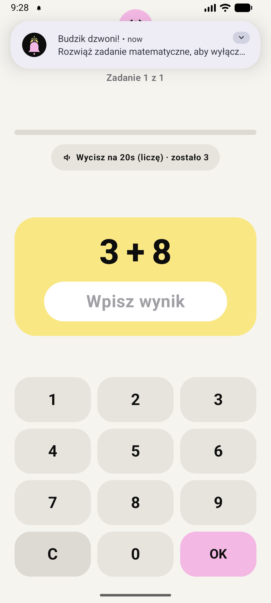

<div align="center">


# Budzik

**Budzik na Androida, którego nie da się wyłączyć, zanim naprawdę się obudzisz.**


</div>

---

## O projekcie

Budzik to natywna aplikacja na Androida napisana w Kotlinie i Jetpack Compose. Żeby wyłączyć alarm, trzeba rozwiązać zadania matematyczne. Aplikacja blokuje też typowe „ucieczki”: przycisk wstecz, ściszanie głośności i restart telefonu.

<div align="center">

</div>

## Funkcje

### Budzenie
- **Zadania matematyczne**: dodawanie na trzech poziomach (łatwy: 1 cyfra, średni: 2 cyfry, trudny: 4 cyfry) i wybrana liczba zadań do rozwiązania.
- **Ekran na blokadzie**: pełnoekranowe dzwonienie, które włącza ekran i pokazuje się nad ekranem blokady.
- **Blokada głośności**: alarm gra na strumieniu `STREAM_ALARM` z maksymalną głośnością, a ściszanie przyciskami jest blokowane.
- **Blokada przycisku wstecz**: z ekranu zadania nie da się po prostu wyjść.
- **Pułapka na restart**: jeśli telefon zrestartuje się w trakcie dzwonienia, alarm wraca zaraz po starcie.
- **„Wycisz na 20 s”**: chwila ciszy na myślenie, maksymalnie 3 razy na jedno dzwonienie.
- **„Sprawdź czy wstałem”**: kontrolny alarm po wyłączeniu głównego, żeby nie zasnąć ponownie.

### Alarmy
- **Serie alarmów**: N alarmów co M minut jednym kliknięciem, z poprawnym przejściem przez północ.
- **Alarmy cykliczne**: wybrane dni tygodnia.
- **Szybka drzemka**: alarm za X minut.
- **Własny dźwięk**: dowolny plik MP3 i opcjonalne wibracje.
- **„Wyczyść wszystko”**: usuwa wszystkie alarmy z bazy i z `AlarmManager` (z potwierdzeniem).

### Niezawodność
- Planowanie przez `AlarmManager.setAlarmClock()`, czyli najpewniejszy sposób budzenia na Androidzie.
- Przywracanie alarmów po restarcie telefonu (`BOOT_COMPLETED`).
- Przeliczanie alarmów po zmianie godziny lub strefy czasowej.
- Pomijanie alarmów przegapionych o ponad 15 minut (np. gdy telefon był wyłączony w nocy).
- Prawdziwe migracje bazy Room: aktualizacja aplikacji nie kasuje alarmów.

## Architektura

Clean Architecture + MVVM:

```
app/src/main/java/com/budzik/alarm/
├── domain/        # Czysty Kotlin: modele, generatory zadań i serii, interfejs repozytorium
├── data/          # Room: encje, DAO, baza, implementacja repozytorium
├── engine/        # AlarmManager, receivery (alarm, boot, zmiana czasu), usługa dzwonienia, AlarmLifecycle
├── sound/         # Zarządzanie dźwiękiem alarmu
└── ui/            # Jetpack Compose: ekran główny, arkusze edycji, ekran dzwonienia, AlarmViewModel
```

| Warstwa | Najważniejsze klasy |
|---|---|
| Domena | `MathProblemGenerator`, `BatchAlarmGenerator`, `Models.kt` |
| Dane | `AlarmDatabase`, `AlarmDao`, `RingingStateDao`, `AlarmRepositoryImpl` |
| Silnik | `AlarmSchedulerImpl`, `AlarmReceiver`, `BootReceiver`, `TimeChangeReceiver`, `AlarmRingingService`, `AlarmLifecycle` |
| UI | `MainActivity`, `MainAlarmScreen`, `RingingActivity`, `AlarmViewModel`, `IosDrumTimePicker` |

## Technologie

- **Kotlin 2.4** i **Jetpack Compose** (Material 3)
- **Room 2.8** + KSP (schemat eksportowany do `app/schemas/`)
- **Coroutines** i **Flow**
- **Gradle 9.8** / **Android Gradle Plugin 9.4**, Java 21
- **JUnit 4** + **Robolectric** do testów

`minSdk 26` (Android 8.0), `targetSdk 35`.

## Budowanie

Potrzebne: Android Studio (lub JDK 21+) i Android SDK.

```bash
git clone https://github.com/rzyrafa/budzik.git
cd budzik
./gradlew assembleDebug
```

Gotowy plik APK pojawi się w `app/build/outputs/apk/debug/`.

> **Uwaga:** `gradle.properties` ustawia `org.gradle.java.home` na lokalną ścieżkę JDK autora. Na swoim komputerze usuń tę linię albo zmień ją na swoją ścieżkę do JDK.

## Testy

```bash
./gradlew test
```

160 testów jednostkowych (Robolectric) w `app/src/test/`:
- generatory zadań i serii, w tym testy brzegowe i „adversarial”,
- silnik alarmów i przeliczanie czasu po zmianie strefy,
- migracja bazy Room,
- scenariusze end-to-end podzielone na poziomy (funkcje, przypadki brzegowe, interakcje funkcji, scenariusze z życia).

## Uprawnienia

| Uprawnienie | Po co |
|---|---|
| `SCHEDULE_EXACT_ALARM` / `USE_EXACT_ALARM` | Dokładne planowanie alarmów |
| `USE_FULL_SCREEN_INTENT` | Ekran dzwonienia na blokadzie |
| `RECEIVE_BOOT_COMPLETED` | Przywracanie alarmów po restarcie |
| `FOREGROUND_SERVICE` / `FOREGROUND_SERVICE_MEDIA_PLAYBACK` | Usługa odtwarzająca dźwięk alarmu |
| `MODIFY_AUDIO_SETTINGS` | Ustawianie maksymalnej głośności alarmu |
| `VIBRATE` | Wibracje podczas dzwonienia |
| `POST_NOTIFICATIONS` | Powiadomienie o dzwoniącym alarmie |
| `WAKE_LOCK` | Wybudzenie urządzenia |
| `SYSTEM_ALERT_WINDOW` | Wyświetlanie nad innymi aplikacjami |
| `REQUEST_IGNORE_BATTERY_OPTIMIZATIONS` | Ochrona przed usypianiem aplikacji przez system |

## Dokumentacja

- [`PROJECT.md`](PROJECT.md): architektura, kontrakty interfejsów, plan prac
- [`PRZEGLAD.md`](PRZEGLAD.md): przegląd kodu, naprawione błędy i dalsze sugestie
- [`TEST_INFRA.md`](TEST_INFRA.md), [`TEST_READY.md`](TEST_READY.md): infrastruktura i plan testów
